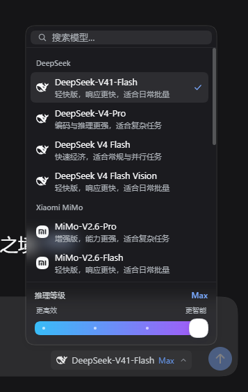
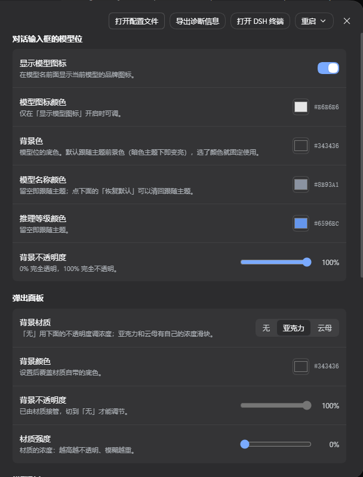

# dsh-model-seat

> 把对话输入框右下角那个不起眼的模型选择器，换成一个真正的「模型席位」。

<div align="center">
  <b>品牌图标 · 分组列表 · 中文简介 · 搜索筛选 · 推理等级滑块 · 可调面板材质</b><br />
  17 项外观设置，全部在设置页里调，随时一键恢复默认。
</div>

<div align="center">
  <a href="./LICENSE"></a>
  
  
</div>

<div align="center">
  
</div>

## 📑 目录

- [✨ 功能一览](#-功能一览)
- [🚀 安装](#-安装)
- [🖼️ 特性巡礼](#️-特性巡礼)
- [⚙️ 设置项一览](#️-设置项一览)
- [🛠️ 开发](#️-开发)
- [📄 许可](#-许可)

## ✨ 功能一览

相比 DSH 内置的模型选择器，这个席位补上的能力：

- **🏷️ 触发器带品牌图标**：按提供方自动匹配 40 个品牌标记（DeepSeek、Claude、GPT、Gemini、Qwen、GLM、Kimi……），未知提供方用中性的四角星兜底；图标颜色可单独调
- **📋 列表每行都有中文简介**：不只知道模型叫什么，还知道它适合干什么（「轻快版，响应更快，适合日常批量」）；鼠标悬停看完整说明
- **🔍 搜索筛选，且面板不会抖**：输入即筛模型名、说明和提供方；面板高度只增不减，过滤时不会跳来跳去
- **🎚️ 推理等级是一条滑条**：青 → 蓝 → 紫渐变，填充是「露出」而不是「挤压」，且在最高档**刻意没有发光特效**
- **⚡ 一次开门办完两件事**：选中模型立即生效、面板不关，可以接着拖推理档位；切到同样支持该档位的模型时，档位自动带过去
- **🪟 面板材质可选**：无 / 亚克力 / 云母三种，配一个强度滑条；底色和不透明度也能单独调
- **🎨 17 项设置，全部实时预览**：改一个开关，输入框里的席位当场就变，不用保存后才看效果

## 🚀 安装

**前置**：已装好 DSH（`dsh web` 能正常运行）。

**方式一：作为 profile bundle（推荐）**

在 profile 目录（`~/.dsh/profiles/default`）里：

```bash
pnpm add "file:../../path/to/dsh-model-seat"
```

然后在同一个目录的 `package.json` 里把包装进 `dsh.profile.bundles`：

```json
{
  "dsh": { "profile": { "bundles": ["dsh-model-seat"] } }
}
```

重启 DSH 即可（bundle 列表在启动时解析，热重载不会重新读它）。

**方式二：本地开发**

仓库里已经带了构建产物 `client.js`，克隆下来直接指向它就能用，无需构建：

```bash
git clone https://github.com/toyvfish/dsh-model-seat.git
```

> ℹ️ 唯一的外部依赖是 peer `@deepseek-ai/schemastery`，它由 DSH 自己提供，不需要单独安装。

## 🖼️ 特性巡礼

### 模型席位：图标、名字和档位一眼看完

触发器上同时显示品牌图标、模型名和当前推理等级。背景色、不透明度、图标颜色、模型名字体色、推理等级字体色，都是独立可调的。

<div align="center">
  
</div>

### 弹出面板：分组、说明、搜索、滑条

按提供方分组，每行带品牌图标和一句中文简介；顶部搜索框支持按模型名、说明、提供方过滤；底部是推理等级滑块。

<div align="center">
  
</div>


### 设置页：17 项可调，改完立刻看到

| 分组 | 选项 |
| --- | --- |
| 对话输入框的模型位 | 显示模型图标 · 模型图标颜色 · 背景色 · 背景不透明度 · 模型名称颜色 · 推理等级颜色 |
| 弹出面板 | 背景材质（无 / 亚克力 / 云母） · 背景颜色 · 背景不透明度 · 材质强度 |
| 模型列表 | 显示搜索框 · 显示模型图标 · 显示模型说明 |
| 推理等级滑块 | 启用渐变 · 单色 · 渐变起始色 / 结束色 |

<div align="center">
  
</div>


## ⚙️ 设置项一览

所有设置都通过宿主的 Config schema 暴露，落在 profile 的 `cordis.patch.yml` 里，因此**跟着配置走**，换机器也能带走。

| 字段 | 默认值 | 说明 |
| --- | --- | --- |
| `triggerLogo` | `true` | 触发器上显示品牌图标 |
| `triggerLogoColor` | `#ffffff` | 图标颜色（关闭图标时不可调） |
| `triggerTint` | `#343436` | 触发器背景色 |
| `triggerOpacity` | `100` | 触发器背景不透明度 |
| `triggerLabelColor` | 跟随主题 | 模型名字体色 |
| `triggerEffortColor` | 跟随主题 | 推理等级字体色 |
| `showSearch` | `true` | 面板顶部搜索框 |
| `menuMaterial` | `none` | 面板材质：`none` / `acrylic` / `mica` |
| `menuMaterialStrength` | `50` | 材质浓度（仅亚克力 / 云母可用） |
| `menuTint` | `#343436` | 面板底色 |
| `menuOpacity` | `100` | 面板底色不透明度（仅「无」可用；亚克力 / 云母自带固定浓度） |
| `listLogo` / `listNote` | `true` | 列表里的图标 / 中文简介 |
| `sliderGradient` | `true` | 推理滑块用渐变还是单色 |
| `sliderSolid` | `#4f8ef7` | 单色模式的颜色 |
| `sliderFrom` / `sliderTo` | `#38bdf8` / `#a855f7` | 渐变两端 |

**两个字段会联动置灰**，而不是静默忽略：关闭「显示模型图标」时图标颜色不可调；材质选亚克力 / 云母时，「背景不透明度」不可调（改用「材质强度」）。

## 🛠️ 开发

```bash
node tools/build.mjs        # 由 src/client.template.js 生成 client.js（内联 40 个品牌 SVG）
node tools/smoke.mjs        # 断言套件：品牌匹配、列表、搜索、滑块、材质、设置页渲染……
node tools/check-schema.mjs # 校验宿主 Config schema 能被真实解析
```

源码是单个手写文件 `src/client.template.js`；`client.js` 是构建产物，但**已提交进仓库**，这样别人克隆下来就能直接用。

`tools/smoke.mjs` 里有一个小型的 React 替身，会把席位和设置页**真的渲染一遍**再断言——设置页曾经因为一个作用域错误在线上整页空白，从那以后它就在测试覆盖里了。

## 📄 许可

[MIT](./LICENSE)
